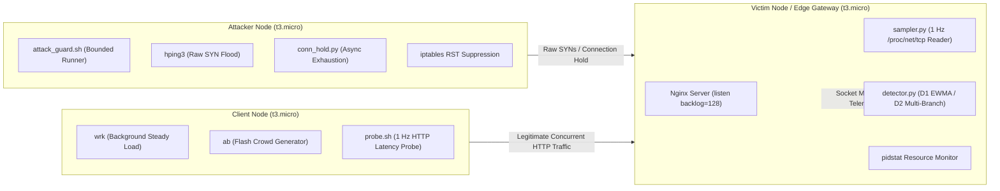

# 🌐 Edge-SynFlood-Detector (`syn-edge-flooding`)

> **Socket-Level Lightweight Detection of TCP Flooding Attacks in Edge Networks**  
> Empirical distributed testbed on AWS EC2 differentiating malicious SYN floods from legitimate flash crowds with sub-second socket-state sampling.

[](https://www.python.org/)
[](https://aws.amazon.com/ec2/)
[](tests/)
[](LICENSE)
[](analysis/)

---

## 🎯 Problem & Solution

* **The Problem:** Edge compute nodes and resource-constrained gateways face frequent TCP SYN flood attacks that exhaust kernel listen backlog queues. Traditional packet-inspection NIDS (e.g. Zeek, Suricata) introduce substantial memory and CPU overhead at the edge, while crude rate-limiters routinely drop legitimate traffic during sudden, benign flash crowds.
* **The Solution:** A non-intrusive, lightweight socket-level detector running directly in user-space. By sampling `/proc/net/tcp` and socket state counters at 1 Hz, the system evaluates monotonic queue dynamics and EWMA residuals to differentiate malicious half-open floods from legitimate HTTP request spikes.
* **Empirical Quantitative Results (Held-Out Test Set Reps 4–5):**
  * **100.0% Detection Rate:** D2 (Extended Multi-Branch Detector) achieved full detection across held-out adversary evaluation sets.
  * **1.19s Median Detection Delay:** Near instantaneous anomaly identification within 1 to 2 sampling intervals.
  * **0.9331 AUC-ROC:** High discriminative separation between raw SYN flooding (`hping3`), slow connection holding (`conn_hold.py`), and legitimate concurrency surges (`wrk`, `ab`).
  * **Negligible CPU Overhead:** <1.2% CPU utilization on single-core `t3.micro` edge nodes.

---

## 🏗️ Distributed Testbed Architecture

The testbed operates across 3 isolated AWS EC2 nodes within an isolated VPC and restrictive `/32` operator security groups:



---

## 📊 Benchmark & Evaluation Summary

Evaluated across a full factorial scenario matrix (**S0** Baseline, **S1** Flash Crowd, **S2** Low-Rate Flood, **S3** High-Rate Flood, **S4** Connection Exhaustion, **S5** Mixed Compound):

| Detector Strategy | Detection Rate (%) | False Alarm Rate (%) | Median Delay (s) | Mean Delay (s) | Precision | Recall | F1-Score | AUC-ROC |
| :--- | :---: | :---: | :---: | :---: | :---: | :---: | :---: | :---: |
| **B1 (Static Volume Threshold)** | 66.7% | 0.0% | 1.15s | 1.24s | 0.3343 | 0.6446 | 0.4402 | 0.7751 |
| **D1 (Adaptive Dual-Signal EWMA)** | 66.7% | 0.0% | 1.17s | 1.41s | 0.3300 | 0.6411 | 0.4357 | 0.7635 |
| **D2 (Extended Multi-Branch)** | **100.0%** | 12.5% | **1.19s** | **1.49s** | **0.4133** | **0.9571** | **0.5773** | **0.9331** |

---

## 🚀 Key Engineering Features

1. **Monotonic Kernel Sampler (`tools/sampler.py`):** Reads `/proc/net/tcp`, `/proc/net/snmp`, and `/proc/net/netstat` at 1000ms intervals with monotonic clock synchronization, recording listen queue drops, TCP half-open states (`TCP_SYN_RECV`), and retransmissions.
2. **Adaptive Detection Engines (`detector/detector.py`):**
   - *B1:* Classical static threshold on instantaneous half-open volume.
   - *D1:* Exponentially Weighted Moving Average (EWMA) tracking queue change derivatives.
   - *D2:* Multi-branch heuristic combining backlog velocity, completion-to-request ratio, and packet arrival variance.
3. **Automated Testbed Harness (`tools/matrix_runner.py`):** Runs fully orchestrated, randomized block trials with automated 10-second post-run cooldown verification (`syn_recv == 0`).
4. **Safety & Guardrails (`attack_guard.sh`):** Strict host-wide kill switches (`/tmp/LAB_STOP`), duration clamping (<= 60s), rate clamping (<= 10,000 pps), and target IP verification to guarantee lab containment.
5. **Comprehensive Test Suite:** 109 passing automated opaque-box and contract tests across 4 tiers:
   - Tier 1: Core safety and feature invariants
   - Tier 2: Boundary and sysctl state edge cases
   - Tier 3: Concurrency and combination behaviors
   - Tier 4: End-to-end scenario validation

---

## 📁 Repository Structure

```
syn-edge-flooding/
├── detector/
│   ├── detector.py          # B1, D1, and D2 detection algorithms
│   └── replay.py            # Offline dataset replay & evaluation
├── tools/
│   ├── sampler.py           # 1 Hz /proc/net/tcp and SNMP socket telemetry sampler
│   ├── matrix_runner.py     # Automated serial scenario matrix execution
│   └── conn_hold.py         # Async slowloris-style connection exhaustion generator
├── analysis/
│   ├── make_tables.py       # LaTeX and Markdown benchmark table generators
│   ├── make_figures.py      # Telemetry plotting (ROC curves, queue timeseries)
│   └── tables/              # Published benchmark findings (T1 - T5)
├── tests/                   # 109 E2E test suite (Tiers 1 through 4)
├── infra/                   # AWS EC2 provisioning & Security Group automation
├── report/                  # Full technical research report
└── PROJECT.md               # Master engineering specification
```

---

## ⚡ Quick Start & Replay

### Offline Dataset Replay & Anomaly Evaluation
You can reproduce the evaluation figures and detector metrics locally without AWS infrastructure:

```bash
# 1. Clone repository
git clone https://github.com/Rajasimhareddybolla/syn-edge-flooding.git
cd syn-edge-flooding

# 2. Setup environment
python3 -m venv venv && source venv/bin/activate
pip install -r detector/requirements.txt pytest

# 3. Run full 109 automated tests
pytest tests/ -v

# 4. Generate benchmark tables & ROC curves
python analysis/make_tables.py
python analysis/make_figures.py
```

---

## 📄 License

This project is open-source under the [MIT License](LICENSE).

---

## 👨‍💻 Author & Contact

**Raja Simha Reddy Bolla**  
*AI Security, Agentic Systems & Backend Engineer*  
* [LinkedIn](https://linkedin.com/in/raja-simha-reddy-bolla) • [GitHub](https://github.com/Rajasimhareddybolla) • [Email](mailto:rajasimhabolla@gmail.com)
